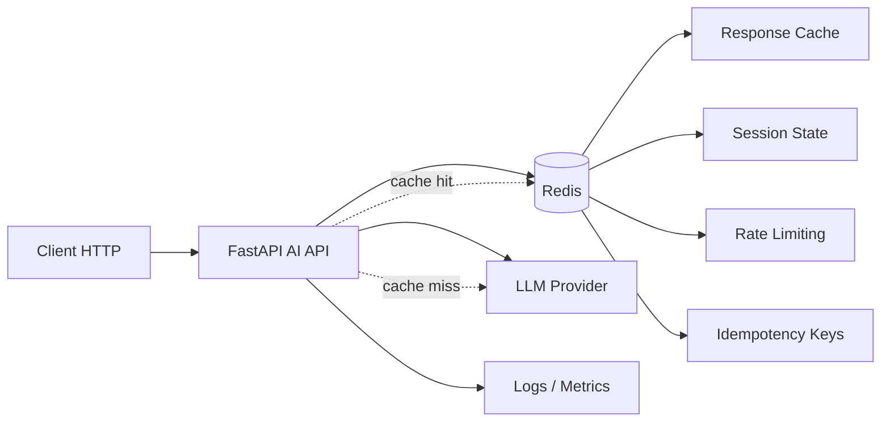

# Semaine 5 — Jour 3 — Redis pour systèmes IA en production

## Position dans le bootcamp

La semaine 5 est consacrée aux systèmes IA en production. Après l'architecture production et l'exposition d'une API FastAPI, ce jour introduit Redis comme couche d'état courte durée, de cache, de limitation de débit et de résilience.

Redis n'est pas présenté comme une simple base clé-valeur. Dans un système d'AI Engineering, Redis devient une brique opérationnelle qui permet de contrôler les coûts LLM, de stabiliser les temps de réponse, de gérer des sessions conversationnelles courtes et d'éviter que l'API ne surcharge les services en aval.

## Livrables du jour

À la fin de la journée, l'apprenant dispose de :

- une compréhension claire des usages de Redis dans une plateforme IA ;
- une stratégie de nommage des clés Redis ;
- un cache LLM avec TTL ;
- une gestion d'état conversationnel court ;
- un rate limiter par utilisateur ;
- un lab FastAPI + Redis exécutable ;
- des exercices et un challenge corrigés.

## Architecture étudiée

## Règle d'ingénierie du jour

Redis doit accélérer et protéger le système, mais ne doit pas devenir la source de vérité durable.

Pour les données durables, on utilisera PostgreSQL au jour suivant. Redis est utilisé ici pour les données volatiles, temporaires, recalculables ou opérationnelles.
