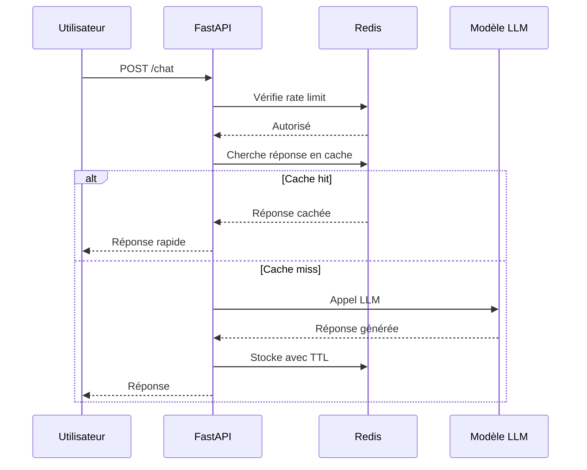

# Chapitre — Redis dans une plateforme IA de production

## 1. Pourquoi Redis apparaît en production IA

Un prototype IA peut appeler directement un modèle à chaque requête. En production, ce modèle naïf devient rapidement coûteux, lent et fragile.

Les appels LLM sont généralement :

- plus chers qu'une lecture mémoire ;
- plus lents qu'une lecture locale ;
- dépendants d'un fournisseur externe ;
- sensibles aux pics de trafic ;
- parfois redondants lorsque plusieurs utilisateurs demandent la même transformation.

Redis répond à ces problèmes par une couche mémoire rapide, simple et opérationnelle. Dans cette journée, on l'utilise pour quatre besoins :

1. cache de réponses ;
2. état conversationnel court ;
3. limitation de débit ;
4. idempotence et protection contre les doublons.

Redis ne remplace pas PostgreSQL. Il complète l'architecture.

## 2. Modèle mental de Redis

Redis est un magasin de données en mémoire, principalement utilisé via des clés. Une clé peut pointer vers plusieurs types de structures :

| Type Redis | Usage AI Engineering |
|---|---|
| String | réponse LLM sérialisée, compteur, flag |
| Hash | métadonnées de session ou profil court |
| List | historique court de messages |
| Set | identifiants uniques, déduplication |
| Sorted Set | fenêtre glissante de rate limiting |
| Stream | file d'événements ou pipeline léger |

Le concept le plus important pour cette journée est le TTL.

Un TTL, ou time to live, définit combien de temps une donnée reste valide. Dans une plateforme IA, le TTL est une décision métier autant qu'une décision technique.

Exemples :

| Donnée | TTL typique | Justification |
|---|---:|---|
| Réponse de classification stable | 24 h à 7 jours | résultat souvent réutilisable |
| Réponse de génération créative | 5 min à 1 h | contexte et attentes variables |
| Session conversationnelle courte | 30 min à 2 h | état temporaire |
| Compteur de rate limit | 1 min à 24 h | contrôle opérationnel |
| Idempotency key | 5 min à 24 h | éviter les doublons |

## 3. Redis dans l'architecture de la semaine 5

Le jour 2 a introduit l'API FastAPI. Le jour 3 ajoute Redis entre l'API et les services coûteux ou fragiles.



La logique importante est la suivante : Redis protège le chemin critique, mais l'API doit continuer à exprimer les règles métier. Redis ne doit pas devenir un endroit où la logique produit est cachée.

## 4. Stratégie de nommage des clés

Un système Redis sans convention devient vite illisible. Chaque clé doit exprimer :

- l'application ;
- l'environnement ;
- le domaine fonctionnel ;
- l'identifiant principal ;
- la version du format si nécessaire.

Convention recommandée :

```text
{app}:{env}:{domain}:{entity}:{id}
```

Exemples :

```text
ai-api:dev:cache:llm:v1:9d2c4a
ai-api:prod:session:user:u_123:conv:c_456
ai-api:prod:ratelimit:user:u_123:minute
ai-api:prod:idempotency:req_789
```

Pourquoi inclure une version ?

Une réponse LLM cachée dépend du prompt système, du modèle, de la température, de la structure de sortie et parfois de la politique produit. Si l'un de ces éléments change, l'ancien cache peut devenir faux. Inclure une version dans la clé permet d'invalider proprement.

## 5. Cache LLM : stratégie cache-aside

La stratégie cache-aside est simple :

1. l'API calcule une clé de cache ;
2. l'API cherche la valeur dans Redis ;
3. si la valeur existe, elle est retournée ;
4. sinon, l'API appelle le modèle ;
5. l'API stocke la réponse dans Redis avec TTL ;
6. l'API retourne la réponse.

```python
import hashlib
import json

def build_llm_cache_key(
    app: str,
    env: str,
    model: str,
    prompt_version: str,
    payload: dict,
) -> str:
    canonical_payload = json.dumps(payload, sort_keys=True, ensure_ascii=False)
    digest = hashlib.sha256(canonical_payload.encode("utf-8")).hexdigest()[:16]
    return f"{app}:{env}:cache:llm:{model}:{prompt_version}:{digest}"
```

Le point critique est la canonicalisation. Deux dictionnaires Python contenant les mêmes champs dans un ordre différent doivent produire la même clé.

## 6. Ce qu'il ne faut pas cacher aveuglément

Un cache LLM peut créer des bugs subtils.

Ne cachez pas une réponse si elle dépend fortement :

- d'une donnée utilisateur sensible ;
- d'une autorisation ;
- d'une date ou d'un événement très récent ;
- d'un état conversationnel non inclus dans la clé ;
- d'une température élevée et volontairement créative ;
- d'une consigne système susceptible de changer.

Mauvais exemple :

```text
cache:summary:{prompt}
```

Bon exemple :

```text
ai-api:prod:cache:summary:v3:model:gpt-x:tenant:t_123:hash:...
```

La clé doit représenter ce qui rend la réponse correcte.

## 7. État conversationnel court

Un assistant conversationnel doit souvent se souvenir des derniers messages. Redis peut stocker cet état court avec expiration.

On évite de stocker un historique infini. On préfère :

- limiter le nombre de messages ;
- expirer la session ;
- stocker uniquement ce qui est utile ;
- éviter les secrets, données médicales, données financières ou données personnelles non nécessaires.

Exemple de structure sérialisée :

```json
{
  "conversation_id": "c_456",
  "user_id": "u_123",
  "messages": [
    {"role": "user", "content": "Résume ce ticket."},
    {"role": "assistant", "content": "Voici le résumé..."}
  ],
  "updated_at": "2026-09-11T09:00:00Z"
}
```

Clé possible :

```text
ai-api:prod:session:user:u_123:conv:c_456
```

TTL possible : 1 heure.

## 8. Rate limiting avec Redis

Un service IA doit limiter les abus. Sans rate limit, un seul client peut consommer le budget LLM de toute l'application.

Un rate limiter simple peut utiliser `INCR` et `EXPIRE`.

Principe :

1. construire une clé par utilisateur et par fenêtre temporelle ;
2. incrémenter le compteur ;
3. poser un TTL à la première requête ;
4. refuser si le compteur dépasse la limite.

```python
async def allow_request(redis, key: str, limit: int, ttl_seconds: int) -> bool:
    count = await redis.incr(key)
    if count == 1:
        await redis.expire(key, ttl_seconds)
    return count <= limit
```

Cette approche est suffisante pour démarrer. Pour une précision plus fine, on peut utiliser une fenêtre glissante avec sorted sets, mais cela augmente la complexité.

## 9. Idempotence

Les clients HTTP peuvent réessayer une requête après un timeout. Sans protection, l'API peut exécuter deux fois la même opération.

Redis permet de stocker une clé d'idempotence :

```text
ai-api:prod:idempotency:{request_id}
```

Si la clé existe, l'API peut retourner la réponse précédente ou refuser le doublon. Cette technique est utile pour :

- lancement d'un job LLM coûteux ;
- envoi de message ;
- écriture en base durable ;
- création d'un rapport.

## 10. Résilience lorsque Redis est indisponible

Redis améliore le système, mais sa panne ne doit pas toujours arrêter l'API.

Il faut distinguer les usages :

| Usage Redis | Comportement si Redis tombe |
|---|---|
| Cache LLM | bypass possible, appel direct au modèle |
| Session conversationnelle | réponse dégradée ou nouvelle session |
| Rate limiting | mode strict ou mode permissif selon risque |
| Idempotence | mode strict recommandé pour opérations critiques |

Pour un service interne de démonstration, on peut autoriser le bypass du cache. Pour un service public payant, on préfère souvent refuser temporairement si le rate limiting est indisponible.

## 11. Sécurité et confidentialité

Redis est rapide, mais ce n'est pas une excuse pour tout stocker.

Bonnes pratiques :

- ne pas stocker de secrets API ;
- ne pas stocker de prompts contenant des données sensibles sans nécessité ;
- utiliser des TTL courts ;
- séparer les environnements ;
- préfixer les clés par application ;
- activer l'authentification en production ;
- chiffrer au niveau infrastructure lorsque nécessaire ;
- éviter les logs de valeurs Redis contenant des prompts complets.

## 12. Observabilité minimale

Chaque usage Redis doit produire des signaux observables.

Mesures utiles :

| Métrique | Pourquoi |
|---|---|
| cache hit rate | mesure l'efficacité du cache |
| cache miss rate | détecte une clé trop spécifique |
| Redis latency | impact sur l'API |
| rate limit blocked count | détecte abus ou limite trop basse |
| session count | estime la charge conversationnelle |
| key eviction count | détecte mémoire insuffisante |

Même sans stack complète de monitoring, le lab journalise les hits, misses et blocages.

## 13. Synthèse

Redis est une brique de production critique pour les systèmes IA, mais elle doit rester simple et explicite.

À retenir :

- le TTL est une décision d'architecture ;
- la clé Redis est un contrat technique ;
- le cache doit inclure le contexte qui rend une réponse correcte ;
- la session courte ne remplace pas la mémoire durable ;
- le rate limiting protège le budget LLM ;
- Redis complète PostgreSQL, il ne le remplace pas.
