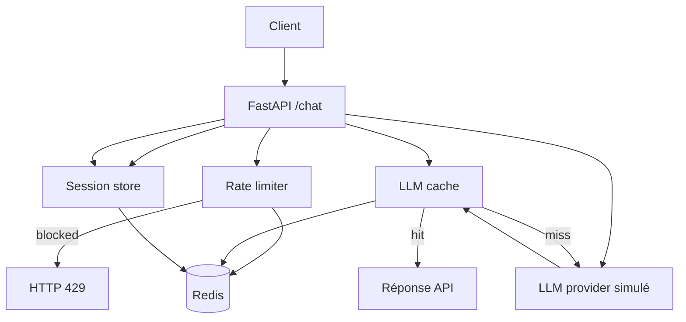

# Corrigé — Challenge

## 1. Diagramme d'architecture



## 2. Table des clés Redis

| Domaine | Format de clé | TTL |
|---|---|---:|
| Cache LLM | `ai-api:{env}:cache:llm:{model}:{prompt_version}:hash:{digest}` | 1 h |
| Session | `ai-api:{env}:session:user:{user_id}:conv:{conversation_id}` | 1 h |
| Rate limit | `ai-api:{env}:ratelimit:user:{user_id}:minute` | 60 s |
| Idempotence | `ai-api:{env}:idempotency:req:{request_id}` | 24 h |

## 3. Code de cache

```python
import hashlib
import json
from typing import Any

def canonical_json(payload: dict[str, Any]) -> str:
    return json.dumps(payload, sort_keys=True, ensure_ascii=False, separators=(",", ":"))

def build_llm_cache_key(app: str, env: str, model: str, prompt_version: str, payload: dict[str, Any]) -> str:
    digest = hashlib.sha256(canonical_json(payload).encode("utf-8")).hexdigest()[:16]
    return f"{app}:{env}:cache:llm:{model}:{prompt_version}:hash:{digest}"

async def get_cached_json(redis, key: str) -> dict[str, Any] | None:
    raw = await redis.get(key)
    if raw is None:
        return None
    return json.loads(raw)

async def set_cached_json(redis, key: str, value: dict[str, Any], ttl_seconds: int) -> None:
    await redis.set(key, json.dumps(value, ensure_ascii=False), ex=ttl_seconds)
```

## 4. Rate limiter

```python
async def allow_request(redis, key: str, limit: int, ttl_seconds: int) -> bool:
    count = await redis.incr(key)
    if count == 1:
        await redis.expire(key, ttl_seconds)
    return count <= limit
```

## 5. Exemple FastAPI

```python
from fastapi import FastAPI, HTTPException
from pydantic import BaseModel

app = FastAPI(title="AI API with Redis")

class ChatRequest(BaseModel):
    user_id: str
    conversation_id: str
    message: str
    model: str = "demo-llm"
    prompt_version: str = "v1"

@app.post("/chat")
async def chat(payload: ChatRequest):
    rate_key = f"ai-api:dev:ratelimit:user:{payload.user_id}:minute"
    allowed = await allow_request(redis, rate_key, limit=20, ttl_seconds=60)
    if not allowed:
        raise HTTPException(status_code=429, detail="Rate limit exceeded")

    cache_payload = {
        "user_id": payload.user_id,
        "conversation_id": payload.conversation_id,
        "message": payload.message,
    }
    cache_key = build_llm_cache_key("ai-api", "dev", payload.model, payload.prompt_version, cache_payload)

    cached = await get_cached_json(redis, cache_key)
    if cached:
        return {"source": "cache", **cached}

    answer = {"answer": f"Réponse simulée à: {payload.message}"}
    await set_cached_json(redis, cache_key, answer, ttl_seconds=3600)
    return {"source": "llm", **answer}
```

## 6. Choix de TTL

- Cache LLM : 1 h pour éviter les réponses obsolètes tout en réduisant les coûts.
- Session : 1 h pour conserver un état court sans créer une mémoire durable.
- Rate limit : 60 s pour une fenêtre minute simple.
- Idempotence : 24 h pour absorber les retries client tardifs.

## 7. Limites

Cette solution utilise un rate limiting à fenêtre fixe. Elle ne gère pas Redis Cluster, la haute disponibilité, le chiffrement applicatif, ni les politiques avancées par tenant. Elle convient à une première API de production, mais devra être renforcée pour une plateforme publique à fort trafic.
