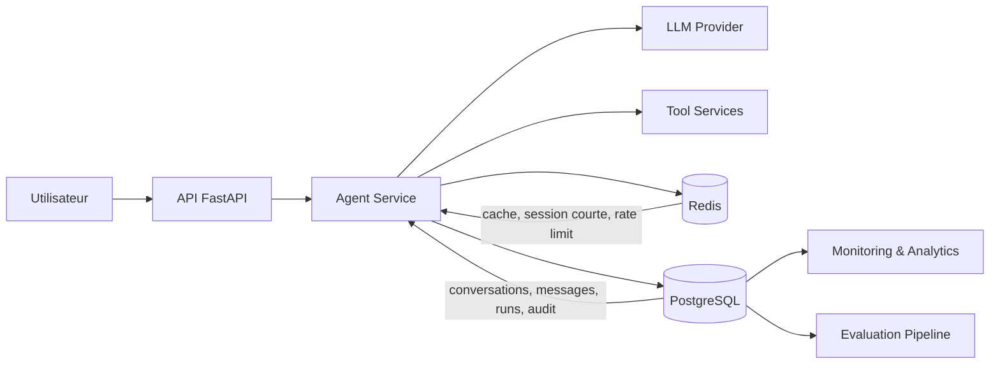
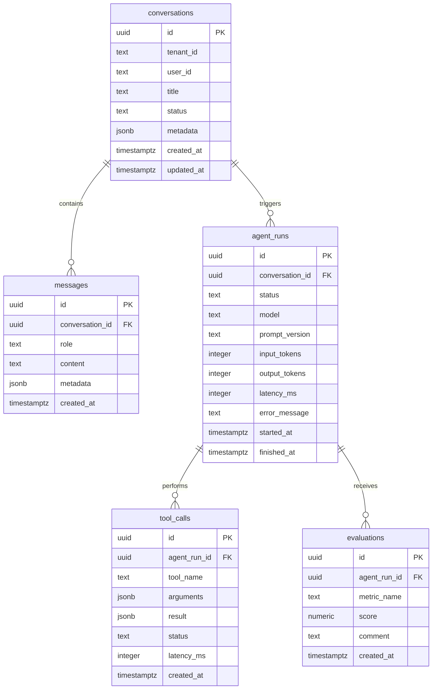
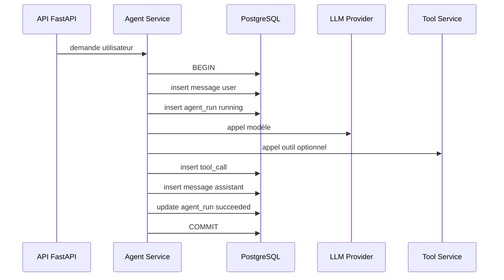

# Chapitre — PostgreSQL pour systèmes IA en production

## 1. Pourquoi PostgreSQL dans une plateforme IA ?

Un système IA en production ne se limite pas à envoyer un prompt à un modèle. Il doit conserver des informations critiques :

- qui a demandé quoi ;
- quelle réponse a été générée ;
- quels outils ont été appelés ;
- quels paramètres ont été utilisés ;
- quelle version de prompt ou de modèle était active ;
- quelles erreurs sont survenues ;
- quelles évaluations ont été produites ;
- quelles décisions doivent être auditables.

Redis est excellent pour l’état temporaire : cache, sessions courtes, verrou distribué, file légère, rate limit. PostgreSQL est utilisé lorsque l’information doit survivre aux redémarrages, être requêtable, cohérente et auditable.

Dans une architecture de production, PostgreSQL devient souvent le **journal durable du système IA**.

## 2. Responsabilités respectives de Redis et PostgreSQL

| Besoin | Redis | PostgreSQL |
|---|---:|---:|
| Cache de réponse | Oui | Non prioritaire |
| Session courte | Oui | Possible mais moins adapté |
| Historique conversationnel durable | Non prioritaire | Oui |
| Audit légal ou métier | Non | Oui |
| Données relationnelles | Limité | Oui |
| Contraintes d’intégrité | Limité | Oui |
| Requêtes analytiques | Limité | Oui |
| Transactions complexes | Limité | Oui |
| Verrouillage court | Oui | Possible |
| Source de vérité | Rarement | Oui |

Une règle simple :

> Redis accélère. PostgreSQL prouve.

## 3. Architecture cible

Le système suivant illustre la place de PostgreSQL dans une application IA de production.



PostgreSQL ne doit pas être utilisé comme simple fichier de logs. Il doit exposer un modèle clair, interrogeable et évolutif.

## 4. Entités principales d’un système IA

Une application IA conversationnelle a généralement besoin des entités suivantes.

### 4.1 Conversation

Une conversation représente un fil d’interaction entre un utilisateur et un assistant.

Champs typiques :

- `id` ;
- `user_id` ;
- `tenant_id` ;
- `title` ;
- `status` ;
- `metadata` ;
- `created_at` ;
- `updated_at`.

### 4.2 Message

Un message représente une entrée ou une sortie conversationnelle.

Champs typiques :

- `id` ;
- `conversation_id` ;
- `role` : `system`, `user`, `assistant`, `tool` ;
- `content` ;
- `metadata` ;
- `created_at`.

### 4.3 Agent run

Un `agent_run` représente une exécution logique de l’agent. Une conversation peut contenir plusieurs runs.

Champs typiques :

- `id` ;
- `conversation_id` ;
- `status` ;
- `model` ;
- `prompt_version` ;
- `input_tokens` ;
- `output_tokens` ;
- `latency_ms` ;
- `error_message` ;
- `started_at` ;
- `finished_at`.

### 4.4 Tool call

Un `tool_call` représente un appel d’outil déclenché pendant un run.

Champs typiques :

- `id` ;
- `agent_run_id` ;
- `tool_name` ;
- `arguments` ;
- `result` ;
- `status` ;
- `latency_ms` ;
- `created_at`.

### 4.5 Evaluation

Une évaluation représente un signal de qualité.

Champs typiques :

- `id` ;
- `agent_run_id` ;
- `metric_name` ;
- `score` ;
- `comment` ;
- `created_at`.

Ces entités permettent de répondre à des questions de production :

- Pourquoi l’agent a-t-il répondu cela ?
- Quel outil a été appelé ?
- Quel modèle était utilisé ?
- Quelle version de prompt était active ?
- Le run a-t-il échoué ?
- Le coût a-t-il augmenté ?
- La qualité a-t-elle baissé ?

## 5. Schéma relationnel

Le schéma suivant représente une base minimale mais robuste.



## 6. Rôle de JSONB

Les systèmes IA changent rapidement. Les métadonnées associées à un message ou à un run peuvent varier :

- version de prompt ;
- paramètres du modèle ;
- température ;
- identifiant externe ;
- stratégie de récupération ;
- nom de workflow ;
- trace de sécurité ;
- signaux de modération.

Créer une colonne pour chaque signal rend le schéma fragile. `JSONB` permet de conserver des métadonnées évolutives.

Exemple :

```json
{
  "model_parameters": {
    "temperature": 0.2,
    "max_output_tokens": 900
  },
  "request_id": "req_123",
  "environment": "production",
  "safety_profile": "standard"
}
```

Cependant, `JSONB` ne remplace pas le modèle relationnel. Une bonne règle :

> Les dimensions stables et requêtées souvent deviennent des colonnes. Les dimensions variables et rarement filtrées restent en JSONB.

## 7. Contraintes d’intégrité

Les contraintes évitent de produire des données incohérentes.

Exemples :

```sql
role text not null check (role in ('system', 'user', 'assistant', 'tool'))
```

```sql
status text not null check (status in ('pending', 'running', 'succeeded', 'failed'))
```

```sql
score numeric not null check (score >= 0 and score <= 1)
```

Ces contraintes ont une valeur forte en AI Engineering. Elles empêchent les états impossibles et rendent les pipelines plus fiables.

## 8. Transactions

Un tour de conversation typique écrit plusieurs éléments :

1. le message utilisateur ;
2. le run agent ;
3. les appels d’outils ;
4. le message assistant ;
5. les métriques du run.

Ces écritures doivent être cohérentes. Si le message assistant est enregistré sans le run correspondant, l’audit devient incomplet. Si un appel d’outil est enregistré sans `agent_run_id`, la trace devient inexploitable.

La transaction garantit que l’ensemble est validé ou annulé.



## 9. Indexation

Les index doivent suivre les accès réels.

Requêtes fréquentes :

- récupérer les conversations d’un utilisateur ;
- récupérer les messages d’une conversation dans l’ordre ;
- retrouver les runs échoués ;
- filtrer par tenant ;
- analyser les runs par modèle ;
- calculer les métriques de qualité.

Index utiles :

```sql
create index if not exists idx_conversations_tenant_user_created
on conversations (tenant_id, user_id, created_at desc);
```

```sql
create index if not exists idx_messages_conversation_created
on messages (conversation_id, created_at asc);
```

```sql
create index if not exists idx_agent_runs_status_started
on agent_runs (status, started_at desc);
```

Un index n’est pas gratuit. Il accélère les lectures mais ralentit les écritures et consomme de l’espace. Il doit répondre à une requête connue.

## 10. Idempotence

Les systèmes IA appellent parfois plusieurs services externes. Des erreurs réseau peuvent provoquer des retries. Sans idempotence, un même message ou un même tool call peut être enregistré deux fois.

Une stratégie consiste à ajouter un identifiant externe unique :

```sql
external_id text unique
```

ou un identifiant d’idempotence par requête :

```sql
idempotency_key text not null unique
```

Dans le lab, cette notion est représentée par le champ `metadata["request_id"]`.

## 11. Multi-tenant et sécurité des données

Dans une plateforme utilisée par plusieurs clients, chaque ligne critique doit être associée à un `tenant_id`.

Cette information permet :

- l’isolation logique ;
- la facturation ;
- l’audit ;
- les exports ;
- les politiques de rétention ;
- la suppression sélective.

Le `tenant_id` doit être présent au niveau des conversations. Les tables enfants héritent du contexte par jointure. Pour des systèmes fortement régulés, il peut aussi être dupliqué dans les tables enfants afin de simplifier les politiques de sécurité.

## 12. Repository pattern

Le code applicatif ne doit pas manipuler directement le SQL partout. Une interface de repository isole la persistance.

Exemple de contrat :

```python
class ConversationStore(Protocol):
    def create_conversation(self, tenant_id: str, user_id: str, title: str) -> Conversation:
        ...

    def append_message(self, conversation_id: str, role: MessageRole, content: str) -> Message:
        ...

    def list_messages(self, conversation_id: str) -> list[Message]:
        ...
```

Avantages :

- tests plus simples ;
- changement d’implémentation possible ;
- séparation entre métier et stockage ;
- meilleure lisibilité ;
- injection de dépendances dans FastAPI.

## 13. Requêtes de production

### Reconstituer une conversation

```sql
select role, content, created_at
from messages
where conversation_id = $1
order by created_at asc;
```

### Trouver les runs échoués

```sql
select id, conversation_id, model, error_message, started_at
from agent_runs
where status = 'failed'
order by started_at desc
limit 50;
```

### Calculer la latence moyenne par modèle

```sql
select model, avg(latency_ms) as avg_latency_ms
from agent_runs
where status = 'succeeded'
group by model
order by avg_latency_ms desc;
```

### Suivre la qualité moyenne par métrique

```sql
select metric_name, avg(score) as avg_score
from evaluations
group by metric_name
order by metric_name;
```

## 14. Anti-patterns

### Anti-pattern 1 — tout stocker en JSON

Cela rend les requêtes difficiles, les contraintes faibles et les migrations dangereuses.

### Anti-pattern 2 — ne pas enregistrer les tool calls

Sans trace d’outil, il devient impossible d’expliquer une réponse agentique.

### Anti-pattern 3 — mélanger cache et source de vérité

Redis peut disparaître. PostgreSQL doit conserver les données critiques.

### Anti-pattern 4 — pas d’horodatage

Sans horodatage fiable, l’analyse de latence, d’incident et de qualité devient fragile.

### Anti-pattern 5 — pas de transaction

Une réponse assistant sans trace de run est une donnée incomplète.

## 15. Synthèse

PostgreSQL est une brique centrale des systèmes IA de production. Il stocke la mémoire durable, les traces, les événements métier et les signaux d’évaluation.

Un bon design PostgreSQL pour l’IA repose sur cinq principes :

1. **durabilité** : conserver les interactions importantes ;
2. **cohérence** : protéger les relations entre messages, runs et outils ;
3. **auditabilité** : expliquer les décisions ;
4. **requêtabilité** : analyser qualité, coût et incidents ;
5. **testabilité** : encapsuler l’accès aux données derrière des contrats.
