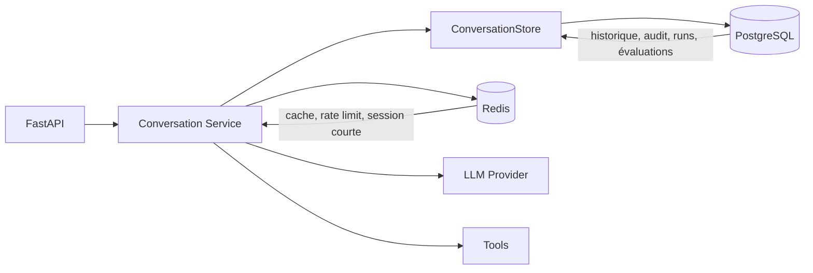

# Corrigé — Challenge Semaine 5 Jour 4

## 1. Architecture proposée



PostgreSQL est la source durable. Redis reste limité aux usages volatils.

## 2. Schéma SQL

```sql
create table conversations (
    id uuid primary key,
    tenant_id text not null,
    user_id text not null,
    title text not null,
    status text not null check (status in ('active', 'archived')),
    metadata jsonb not null default '{}'::jsonb,
    created_at timestamptz not null default now(),
    updated_at timestamptz not null default now()
);

create table messages (
    id uuid primary key,
    conversation_id uuid not null references conversations(id) on delete cascade,
    role text not null check (role in ('system', 'user', 'assistant', 'tool')),
    content text not null,
    metadata jsonb not null default '{}'::jsonb,
    created_at timestamptz not null default now()
);

create table agent_runs (
    id uuid primary key,
    conversation_id uuid not null references conversations(id) on delete cascade,
    status text not null check (status in ('pending', 'running', 'succeeded', 'failed')),
    model text not null,
    prompt_version text not null,
    input_tokens integer not null default 0 check (input_tokens >= 0),
    output_tokens integer not null default 0 check (output_tokens >= 0),
    latency_ms integer check (latency_ms is null or latency_ms >= 0),
    error_message text,
    started_at timestamptz not null default now(),
    finished_at timestamptz
);

create table tool_calls (
    id uuid primary key,
    agent_run_id uuid not null references agent_runs(id) on delete cascade,
    tool_name text not null,
    arguments jsonb not null default '{}'::jsonb,
    result jsonb,
    status text not null check (status in ('pending', 'running', 'succeeded', 'failed')),
    latency_ms integer check (latency_ms is null or latency_ms >= 0),
    created_at timestamptz not null default now()
);

create table evaluations (
    id uuid primary key,
    agent_run_id uuid not null references agent_runs(id) on delete cascade,
    metric_name text not null,
    score numeric not null check (score >= 0 and score <= 1),
    comment text,
    created_at timestamptz not null default now()
);
```

## 3. Index

```sql
create index idx_conversations_tenant_user_created
on conversations (tenant_id, user_id, created_at desc);

create index idx_messages_conversation_created
on messages (conversation_id, created_at asc);

create index idx_agent_runs_status_started
on agent_runs (status, started_at desc);

create index idx_agent_runs_model_started
on agent_runs (model, started_at desc);

create index idx_tool_calls_run_created
on tool_calls (agent_run_id, created_at asc);

create index idx_evaluations_metric_created
on evaluations (metric_name, created_at desc);
```

## 4. Repository Python

```python
from typing import Protocol
from .domain import Conversation, Message, MessageRole

class ConversationStore(Protocol):
    def create_conversation(self, tenant_id: str, user_id: str, title: str) -> Conversation:
        ...

    def append_message(self, conversation_id: str, role: MessageRole, content: str) -> Message:
        ...

    def list_messages(self, conversation_id: str) -> list[Message]:
        ...
```

## 5. Stratégie transactionnelle

Pour un tour de conversation :

1. ouvrir une transaction ;
2. insérer le message utilisateur ;
3. créer le `agent_run` en `running` ;
4. enregistrer les appels d’outils ;
5. insérer le message assistant ;
6. marquer le run `succeeded` ;
7. valider la transaction.

En cas d’erreur, conserver un run `failed` avec `error_message` lorsque l’information est utile au debug.

## 6. Anti-patterns

- Stocker tout l’état durable dans Redis.
- Conserver uniquement le texte des messages.
- Ne pas tracer les tool calls.
- Stocker toutes les données en JSONB.
- Omettre les timestamps.
- Utiliser des index sans requêtes cibles.
- Mélanger SQL métier et endpoints FastAPI.
- Tester uniquement avec une vraie base externe.

## 7. Plan de migration depuis une table `messages`

1. Ajouter les nouvelles tables.
2. Créer les conversations manquantes.
3. Ajouter `conversation_id` aux messages existants.
4. Migrer les anciens messages vers la nouvelle table si nécessaire.
5. Déployer une écriture duale temporaire.
6. Valider les volumes et les requêtes.
7. Basculer la lecture vers le nouveau modèle.
8. Supprimer l’ancien chemin après période d’observation.

## 8. Bonus — evaluation_runs

```sql
create table evaluation_runs (
    id uuid primary key,
    name text not null,
    model text not null,
    prompt_version text not null,
    environment text not null,
    created_at timestamptz not null default now()
);
```

Cette table permet de comparer plusieurs séries d’évaluations par version de prompt, modèle ou environnement.
