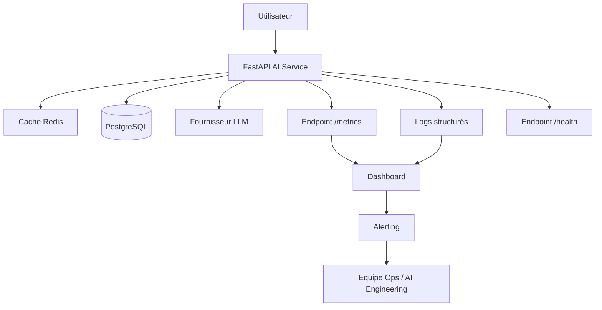
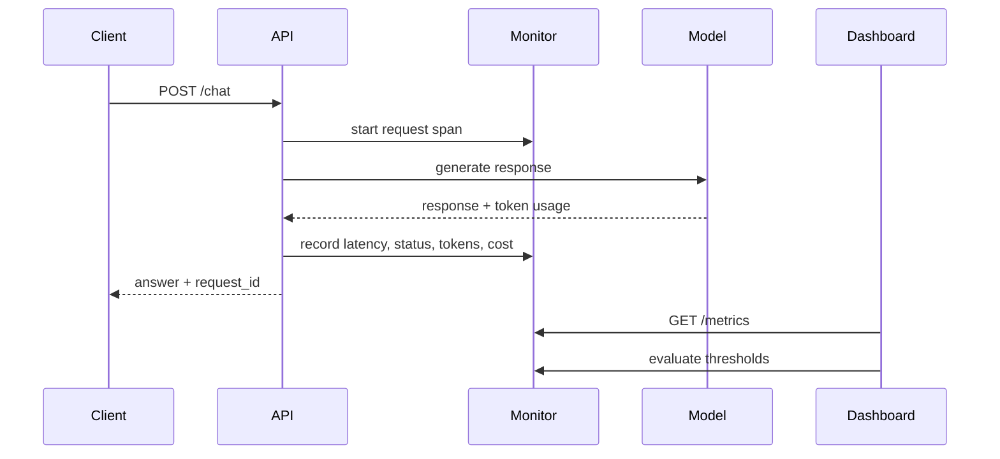

# Chapitre — Monitoring des systèmes IA en production

## 1. Pourquoi le monitoring IA est différent

Le monitoring d’une API classique répond souvent à trois questions :

1. le service est-il disponible ?
2. répond-il assez vite ?
3. produit-il trop d’erreurs ?

Ces questions restent nécessaires pour une API IA, mais elles sont insuffisantes. Une API IA peut répondre rapidement et sans erreur HTTP tout en produisant une réponse inutilisable.

Un système IA introduit plusieurs sources de risque supplémentaires :

- coût variable selon les tokens consommés ;
- latence variable selon la taille du prompt et du modèle ;
- qualité difficile à mesurer automatiquement ;
- dépendance à des fournisseurs externes ;
- comportement probabiliste ;
- risques de fuite de données dans les prompts et logs ;
- erreurs métier non visibles dans les codes HTTP.

Le monitoring IA doit donc enrichir l’observabilité classique avec des signaux métier et modèle.

## 2. Les quatre piliers opérationnels

Dans un système IA en production, quatre familles de signaux sont particulièrement importantes.

### 2.1 Logs

Les logs décrivent des événements.

Exemple :

```json
{
  "event": "ai_request_completed",
  "request_id": "req_123",
  "route": "/chat",
  "status_code": 200,
  "latency_ms": 842,
  "model": "gpt-example",
  "prompt_tokens": 312,
  "completion_tokens": 84,
  "estimated_cost_usd": 0.0048
}
```

Un bon log est structuré, filtré, corrélable et exploitable.

Un mauvais log contient une chaîne de texte impossible à agréger ou expose directement des informations sensibles.

### 2.2 Métriques

Les métriques agrègent des mesures dans le temps.

Exemples :

- nombre de requêtes ;
- taux d’erreur ;
- latence moyenne ;
- latence P95 ;
- tokens consommés ;
- coût estimé ;
- nombre de refus ;
- nombre de réponses vides ;
- nombre de dépassements de budget.

Les métriques doivent être peu coûteuses à produire et faciles à agréger.

### 2.3 Traces

Les traces décrivent le parcours d’une requête à travers plusieurs composants.

Dans un système IA, une requête peut traverser :

1. l’API ;
2. un cache Redis ;
3. une base PostgreSQL ;
4. un orchestrateur d’agent ;
5. un outil externe ;
6. un fournisseur LLM ;
7. un composant de post-traitement.

Sans trace, il devient difficile d’identifier l’étape responsable d’une lenteur.

### 2.4 Alertes

Les alertes transforment des métriques en actions.

Une bonne alerte doit être :

- actionnable ;
- compréhensible ;
- liée à un seuil explicite ;
- associée à un runbook ;
- limitée pour éviter la fatigue d’alerte.

Une mauvaise alerte se déclenche trop souvent ou ne dit pas quoi faire.

## 3. Architecture de monitoring

Le schéma suivant montre une architecture minimale de monitoring pour une API IA.



Cette architecture sépare les responsabilités :

- l’API produit les signaux ;
- les dashboards les rendent lisibles ;
- les alertes déclenchent une action ;
- les runbooks guident l’intervention.

## 4. Métriques techniques indispensables

Une API IA doit au minimum suivre :

| Métrique | Description | Pourquoi c’est important |
|---|---|---|
| `request_count` | nombre total de requêtes | mesure le trafic |
| `error_count` | nombre d’erreurs | détecte les incidents |
| `error_rate` | erreurs / requêtes | signale une dégradation |
| `avg_latency_ms` | latence moyenne | suit la performance globale |
| `p95_latency_ms` | 95e percentile de latence | détecte les lenteurs utilisateur |
| `status_code_count` | distribution des codes HTTP | identifie les erreurs dominantes |
| `dependency_latency_ms` | latence des dépendances | localise les goulots |
| `uptime_seconds` | durée depuis le démarrage | aide au diagnostic |

La latence P95 est souvent plus utile que la moyenne, car elle reflète mieux l’expérience des utilisateurs les plus impactés.

## 5. Métriques spécifiques IA

Les métriques IA complètent les métriques techniques.

| Métrique | Description | Exemple d’usage |
|---|---|---|
| `prompt_tokens` | tokens en entrée | détecter les prompts trop longs |
| `completion_tokens` | tokens en sortie | suivre la verbosité |
| `total_tokens` | somme entrée + sortie | piloter le coût |
| `estimated_cost_usd` | coût estimé | surveiller le budget |
| `model_name` | modèle utilisé | comparer les performances |
| `cache_hit` | réponse servie depuis cache | mesurer l’efficacité Redis |
| `empty_response_count` | réponses vides | détecter un problème fonctionnel |
| `refusal_count` | refus ou blocages | analyser les limites produit |
| `quality_score` | score interne ou évaluation | suivre la qualité |
| `tool_call_count` | nombre d’appels d’outils | détecter les agents trop bavards |

Ces métriques doivent être collectées sans stocker inutilement les prompts bruts.

## 6. Les SLO d’un système IA

Un SLO, ou Service Level Objective, définit un objectif mesurable.

Exemples :

- 99 % des requêtes `/chat` répondent en moins de 3 secondes ;
- le taux d’erreur reste inférieur à 1 % sur 15 minutes ;
- le coût journalier reste inférieur à 50 dollars ;
- moins de 2 % des réponses sont vides ;
- le cache Redis sert au moins 30 % des requêtes répétées.

Un SLO n’est pas une promesse abstraite. C’est un contrat exploitable qui guide le monitoring, les alertes et les priorités techniques.

## 7. Exemple de contrat de métriques

Un endpoint `/metrics` minimal peut retourner un document JSON :

```json
{
  "request_count": 1200,
  "error_count": 18,
  "error_rate": 0.015,
  "avg_latency_ms": 812.4,
  "p95_latency_ms": 1840.0,
  "total_prompt_tokens": 210000,
  "total_completion_tokens": 72000,
  "estimated_cost_usd": 4.92
}
```

Dans un environnement réel, ces métriques seraient souvent exposées au format Prometheus. Dans ce bootcamp, le JSON est suffisant pour comprendre et tester les principes.

## 8. Corrélation par request id

Chaque requête doit recevoir un identifiant unique.

Cet identifiant est propagé dans :

- les logs ;
- les enregistrements internes du lab ;
- les traces ;
- les erreurs retournées au client ;
- les appels aux dépendances.

Exemple :

```text
request_id=req_01HZX route=/chat latency_ms=642 model=gpt-example status=200
```

Sans identifiant de corrélation, le diagnostic devient difficile dès que plusieurs utilisateurs sollicitent le système en même temps.

## 9. Monitoring du coût

Le coût d’une API IA n’est pas fixe. Il dépend généralement :

- du modèle utilisé ;
- des tokens d’entrée ;
- des tokens de sortie ;
- des appels d’outils ;
- des retries ;
- du cache ;
- du volume utilisateur.

Une estimation simple peut être formulée ainsi :

```text
coût = prompt_tokens / 1000 * prix_input
     + completion_tokens / 1000 * prix_output
```

Même approximative, cette mesure est utile pour :

- détecter une régression de prompt ;
- identifier un utilisateur ou cas d’usage coûteux ;
- déclencher une alerte de budget ;
- comparer plusieurs architectures.

## 10. Monitoring de la qualité

La qualité est la partie la plus difficile.

Une réponse IA peut être :

- techniquement valide ;
- grammaticalement correcte ;
- mais fausse, incomplète ou dangereuse.

Pour un premier système, on peut commencer avec des signaux simples :

- réponse vide ;
- réponse trop courte ;
- réponse trop longue ;
- présence d’une phrase de fallback ;
- score d’un évaluateur automatique ;
- feedback utilisateur ;
- divergence avec une réponse attendue ;
- nombre de reformulations nécessaires.

Ces signaux ne remplacent pas une évaluation robuste, mais ils permettent de détecter rapidement une dégradation.

## 11. Redaction des données sensibles

Le monitoring ne doit pas devenir une fuite de données.

Avant de logger un prompt, une sortie ou un message d’erreur, il faut filtrer :

- emails ;
- numéros de téléphone ;
- clés API ;
- tokens d’accès ;
- secrets ;
- informations personnelles ;
- contenus client confidentiels.

Dans beaucoup de systèmes, le choix le plus sûr consiste à ne pas logger le prompt complet. On conserve plutôt :

- longueur ;
- hash ;
- type de tâche ;
- langue ;
- utilisateur ou tenant pseudonymisé ;
- nombre de tokens.

## 12. Alerting minimal

Une règle d’alerte doit combiner une condition et une action.

Exemple :

```yaml
name: high_error_rate
condition: error_rate > 0.05
severity: critical
runbook: check_recent_deployments_and_provider_status
```

Les premières règles utiles sont :

- taux d’erreur élevé ;
- P95 trop élevé ;
- coût estimé trop élevé ;
- trop de réponses vides ;
- dépendance indisponible ;
- absence de trafic attendu.

## 13. Runbook

Un runbook est une procédure de diagnostic.

Exemple pour une hausse de latence :

1. vérifier si la hausse concerne toutes les routes ;
2. comparer latence API et latence fournisseur LLM ;
3. vérifier les appels Redis et PostgreSQL ;
4. inspecter les prompts récents ;
5. vérifier les retries ;
6. regarder les changements de déploiement ;
7. appliquer mitigation : cache, rollback, réduction de contexte, fallback modèle.

Le runbook transforme une alerte en action opérationnelle.

## 14. Patterns de conception

Un bon monitoring doit être découplé du code métier.

Mauvais pattern :

```python
def chat(prompt):
    start = time.time()
    response = call_model(prompt)
    print("latency", time.time() - start)
    return response
```

Meilleur pattern :

```python
def chat(prompt, monitor):
    with monitor.track("chat"):
        response = call_model(prompt)
        monitor.record_tokens(prompt_tokens=120, completion_tokens=60)
        return response
```

L’objectif est de rendre la collecte testable, réutilisable et évolutive.

## 15. Exemple de cycle production



Ce cycle montre que le monitoring n’est pas une tâche secondaire. Il fait partie du chemin de production.

## 16. Ce qu’il faut éviter

À éviter :

- logger les prompts complets sans filtrage ;
- confondre uptime et qualité ;
- surveiller uniquement la moyenne de latence ;
- déclencher des alertes sans runbook ;
- ignorer les coûts ;
- ajouter des métriques non utilisées ;
- mélanger métriques techniques et données personnelles ;
- monitorer uniquement le fournisseur LLM ;
- ne pas tester la logique de monitoring.

## 17. Synthèse

Un système IA production-ready doit être observable.

Le monitoring répond à trois questions opérationnelles :

1. le système fonctionne-t-il ?
2. fonctionne-t-il bien ?
3. fonctionne-t-il à un coût et un niveau de risque acceptables ?

Pour un AI Backend Engineer ou AI Solution Architect, le monitoring est une compétence centrale. Il permet de passer d’une démonstration IA à un service fiable, exploitable et améliorable.


## 18. Du lab vers la production : limites à comprendre

Le lab expose `/metrics` en JSON : Prometheus ne peut pas collecter directement
ce contrat. Son adaptation nécessite un client d'instrumentation et un endpoint
au format d'exposition Prometheus. Les règles YAML fournies sont pédagogiques,
pas des règles Prometheus exécutables. `/alerts` évalue les seuils seulement
lorsqu'il est appelé et ne transmet aucune notification.

Les compteurs, coûts et percentiles sont calculés depuis le démarrage du processus.
Ils ne représentent ni une fenêtre de quinze minutes ni un budget journalier.
Une alerte de coût cumulatif reste donc active après le franchissement du seuil.
Pour un SLO, préciser la fenêtre, les requêtes éligibles et le volume minimal avant
une alerte. Le P95 local ne doit jamais être moyenné entre plusieurs instances.

Le collecteur conserve tous les événements en mémoire : le lab s'exécute avec un
seul worker et une charge limitée. En production, utiliser des compteurs et des
histogrammes exportés vers un stockage de séries temporelles. Garder `request_id`
dans les logs et traces, jamais dans les labels de métriques : chaque identifiant
créerait une nouvelle série. Les labels route, modèle et statut doivent avoir un
nombre de valeurs borné.

`/health` vérifie ici un service simulé. Il ne teste pas Redis, PostgreSQL ou un
fournisseur LLM réel. Distinguer liveness (processus vivant) et readiness (capacité
à servir). Les métriques de refus, cache et qualité présentées dans le chapitre
sont des pistes d'extension, pas des mesures déjà implémentées.

Le nombre de tokens est une approximation par caractères et les prix sont des
hypothèses pédagogiques. Utiliser les compteurs de consommation du fournisseur
et ses tarifs configurés pour la facturation réelle. Une réponse vide est un
signal de qualité ; elle ne mesure pas la factualité. Les expressions régulières
de masquage ne garantissent pas une anonymisation exhaustive. Le middleware
journalise des métadonnées sans enregistrer le contenu utilisateur.
