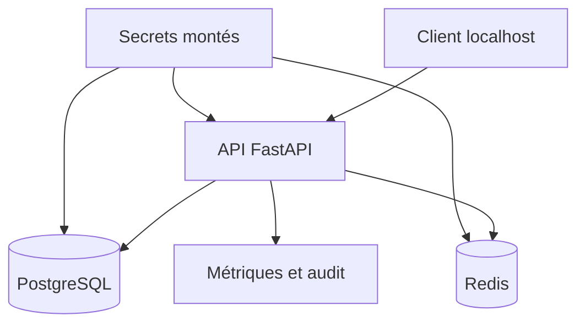

# Chapitre — Livrer un service IA exploitable

## 1. Déployer n'est pas seulement lancer un processus

Aux jours précédents, les composants étaient testables séparément. Maintenant il
faut réunir code, configuration, données et politique de sécurité dans une exécution
contrôlée. Un service qui démarre peut encore être incapable de servir : mauvais
schéma SQL, mot de passe périmé, Redis inaccessible, cache mal partitionné.

Le déploiement doit répondre à quatre questions : quelle version tourne, avec
quelle configuration, sur quelles données et comment revenir à un état utilisable ?

Le lab choisit Docker Compose sur un seul hôte. C'est un périmètre adapté à une
première stack reproductible. Il ne constitue pas une architecture à haute disponibilité.
Vous connaissez déjà Docker et les pipelines : l'objectif est d'appliquer leurs
mécanismes aux particularités d'un backend IA.

## 2. Image, conteneur, configuration, données

| Élément | Contenu | Cycle de vie |
|---|---|---|
| Image API | Code, interpréteur et dépendances | Construite une fois par version |
| Conteneur | Processus API et filesystem d'exécution | Remplaçable |
| Configuration | Hôtes, nom de base, référence de release | Fournie au démarrage |
| Secrets | Clés client et mots de passe | Distribués avec accès limité |
| Volumes | Données PostgreSQL, état Redis | Conservés entre remplacements |

Reconstruire l'image ne met pas automatiquement à jour la base. Redémarrer un
conteneur ne réinitialise pas ses volumes. Remplacer un secret PostgreSQL dans un
fichier ne change pas le mot de passe déjà enregistré dans une base existante.
Ces distinctions expliquent une grande partie des incidents de premier déploiement.

## 3. Architecture du lab

Seule l'API publie le port 8000, lié à `127.0.0.1`. PostgreSQL et Redis restent sur
un réseau backend interne. L'API est également connectée à un réseau frontend,
ce qui permettra ultérieurement une connexion à un vrai fournisseur LLM.

Le lab ne fournit pas de reverse proxy TLS. Il n'est donc pas configuré pour être
exposé directement sur Internet. Un déploiement public ajoute TLS, contrôle d'entrée,
limite de corps HTTP, délais et limitation avant authentification.

Le réseau interne réduit l'exposition ; il ne remplace ni authentification ni
moindre privilège. Redis exige un mot de passe. PostgreSQL possède un compte
applicatif de lecture, distinct du compte administrateur de bootstrap.

## 4. Construire l'image avec une responsabilité précise

Le Dockerfile utilise une image Python slim, installe les dépendances runtime et
copie uniquement le package applicatif. Il crée l'UID/GID 10001 puis exécute Uvicorn
par un CMD au format exec. Aucun mode `--reload` n'est activé.

`.dockerignore` applique une liste d'inclusion : seuls le code et les fichiers de
dépendances nécessaires entrent dans le contexte. Les secrets, tests et environnements
virtuels ne sont pas envoyés au moteur de build.

L'UID 10001 n'est pas un utilisateur IAM ni un compte client. C'est l'identité Linux
du processus dans le conteneur. Le filesystem API est en lecture seule ; `/tmp` est
un tmpfs borné. Les capacités Linux sont retirées et l'élévation de privilèges interdite.

Le fichier `requirements.lock` contient les versions runtime résolues pour Linux et
Python 3.12. Il évite un choix implicite différent des dépendances transitives lors
d'un build. Il n'inclut pas les dépendances de test. Ce n'est pas un lock multi-plateforme
avec hashes : ce niveau supplémentaire reste une amélioration d'industrialisation.

Les images de base Python, PostgreSQL et Redis utilisent ici des tags de gamme pour
la facilité du lab. Ces tags sont mutables. Pour une livraison durable, enregistrer
et tester leurs digests, le commit de source, l'architecture et les résultats de scan.
Un tag `release-001` lisible ne prouve pas à lui seul l'immutabilité ; une référence
`image@sha256:...` la rend explicite pour une image publiée dans un registry.

## 5. Secrets : montage et moindre privilège

Le script `configure_demo.py` crée des valeurs aléatoires sans les afficher. Chaque
service reçoit seulement les secrets nécessaires : l'API ne reçoit jamais le mot de
passe administrateur PostgreSQL.

Les secrets sont montés en fichiers sous `/run/secrets`. L'environnement ne contient
que leurs chemins et la configuration non sensible. Le code les lit au démarrage et
refuse une configuration absente ou invalide.

Avec Compose et des fichiers locaux, il ne s'agit pas d'un coffre-fort chiffré.
Le répertoire hôte `secrets/` est privé en mode 0700 sur Unix. Les fichiers sont
lisibles en mode 0444 pour que les UID des services puissent les lire après montage.
Cette combinaison est volontaire : les implémentations de secrets basées sur des
bind mounts ne garantissent pas un remappage d'UID/mode par la déclaration Compose.
Sur un autre OS, vérifier les ACL et le comportement du moteur Docker.

Une rotation doit coordonner le fichier, l'état du service cible et ses consommateurs.
Le script refuse de régénérer un dossier existant pour éviter de désynchroniser
les mots de passe d'une base déjà initialisée. La suppression du dossier de secrets
n'est pas une méthode de rotation.

## 6. Ordre de démarrage et santé

Compose peut attendre des dépendances déclarées `service_healthy` avant de créer
l'API. C'est utile pour la première ouverture de PostgreSQL et Redis. Cette attente
ne garantit pas qu'ils resteront disponibles après le démarrage.

`pg_isready` constate qu'un serveur PostgreSQL accepte les connexions ; il ne prouve
pas que le compte applicatif lit le bon schéma. La readiness API vérifie donc la
table `schema_version` via le compte applicatif et attend la version 1.

| Contrôle | Question | Comportement du lab |
|---|---|---|
| `/health/live` | Le processus peut-il répondre ? | Ne consulte pas les dépendances |
| `/health/ready` | Le service peut-il traiter son contrat ? | Consulte schéma SQL et Redis |
| Healthcheck Compose API | Le conteneur passe-t-il le contrôle de livraison ? | Utilise readiness |
| Smoke tests | Les fonctions importantes sont-elles correctes ? | Auth, données, cache, métriques |

Un problème PostgreSQL donne une readiness 503 sans faire tomber la liveness.
Redémarrer continuellement une API parce qu'une base est momentanément indisponible
peut aggraver l'incident. Docker ne redémarre pas automatiquement un conteneur
simplement parce qu'il est marqué unhealthy ; sa politique de restart concerne
l'arrêt du processus.

Les probes comportent des timeouts. La connexion PostgreSQL est bornée à trois
secondes et ses requêtes à deux secondes ; Redis est borné à deux secondes. La
readiness consulte les deux séquentiellement et reste sous le timeout du healthcheck.
Des délais réseau différents doivent être validés dans l'environnement cible.

## 7. Données et schéma : initialiser n'est pas migrer

Le bootstrap PostgreSQL s'exécute à l'initialisation d'un volume vide. Il crée un
compte de lecture, le schéma minimal et les documents alpha/beta.

Les scripts de `/docker-entrypoint-initdb.d` ne sont pas rejoués sur un volume
existant. Modifier le script puis relancer Compose ne constitue donc pas une migration.
Pour une évolution réelle, utiliser un mécanisme de migration versionné, une
identité privilégiée dédiée et une étape de livraison observable.

La requête documentaire applique le tenant du principal dans son WHERE et passe
les arguments au driver. Le contrôle précède le cache. Le compte applicatif ne peut
ni modifier les documents ni créer une table ; l'isolation par tenant reste ici
appliquée par le code SQL, sans Row Level Security.

Le volume PostgreSQL conserve les données lorsque l'API ou la stack est arrêtée
avec `docker compose down`. L'option `--volumes` détruit les volumes nommés de cette
stack : elle est réservée au nettoyage explicite d'un lab jetable ou d'un runner CI.

Un volume n'est pas une sauvegarde. Avant une migration, prévoir sauvegarde et test
de restauration. Revenir à l'image précédente ne remet pas automatiquement la base
dans son ancien schéma.

## 8. Cache et quotas à plusieurs processus

Le cache de réponses inclut tenant, sujet, version du contrat et une empreinte du
message et du contenu documentaire. Le document est relu et autorisé avant tout
cache hit. Une mise à jour de son contenu change l'empreinte ; une révocation empêche
la lecture avant de consulter le cache.

Cette relecture réduit le gain sur l'accès SQL mais conserve le gain éventuel sur
l'appel LLM. C'est un compromis explicite de ce lab. Une architecture plus performante
peut utiliser une version d'ACL et de document, à condition de maîtriser l'invalidation.
Les réponses sont conservées 120 secondes ; leur présence dans Redis reste une
forme de stockage de données sensibles. Le préfixe `answer:v1` doit être changé si
le contrat de génération, le prompt ou le modèle change. `APP_RELEASE` ne l’invalide
pas automatiquement : une nouvelle image peut sinon réutiliser une ancienne réponse.

Le quota passe du verrou local du jour 6 à un script Lua atomique dans Redis. Le
contrôle, l'incrément et l'expiration sont réalisés dans la même invocation. Le
couple tenant/sujet partage le quota entre instances ; changer de clé ne l'annule pas.

Redis porte désormais une frontière de consommation : si le limiteur est inaccessible,
l'API renvoie 503 au lieu d'accepter des appels sans borne. Le cache ne peut donc pas
être considéré ici comme une dépendance entièrement facultative. Distinguer les
politiques de cache et de quota dans une architecture plus avancée.

Redis est configuré `noeviction` pour éviter qu'une pression mémoire supprime un
compteur de quota et accorde un nouveau budget. Une saturation provoque des erreurs
à traiter et à surveiller. AOF `everysec` améliore la persistance mais ne donne pas
une garantie de conservation de chaque incrément en cas de crash. Pour un budget
financier strict, définir des garanties et un rapprochement adaptés.

Une fenêtre fixe limite dix appels sur soixante secondes à partir du premier appel.
Elle autorise une rafale autour de sa frontière ; elle n'est pas un plafond monétaire
ni une protection complète contre des requêtes anonymes.

## 9. Observabilité lors d'une release

Le lab expose des compteurs HTTP, un histogramme de latence et les cache hits au
format Prometheus. `/metrics` demande le scope `metrics:read`, attribué à une identité
d'exploitation distincte. Une clé de chat ne donne pas cet accès.

Les labels sont route et statut. Ni clé, ni sujet, ni request_id ne créent une série
de métrique. L'audit JSON conserve des métadonnées et un identifiant généré par le
serveur sans lire le prompt. Les logs Docker sont bornés en taille et nombre de fichiers.
Ils doivent ensuite être collectés selon la politique de l'environnement.

Le lab lance un seul worker API. Les métriques sont locales à ce processus ; un
passage à plusieurs workers impose une collecte adaptée ou plusieurs conteneurs
scrapés séparément. Le quota partagé via Redis ne résout pas cette question de métriques.

Les tokens et coûts réels ne sont pas mesurés parce que le modèle est simulé.
Ne pas présenter un compteur d'appels comme une mesure de facturation.

## 10. Pipeline : build une fois, promouvoir le résultat

Une chaîne de livraison vérifie le code et les contrats, scanne les dépendances et
l'image, construit une image identifiée, puis teste cette image dans un environnement
jetable. La promotion utilise ensuite le même digest, plutôt qu'un nouveau build
avec potentiellement d'autres dépendances.

Le fichier `assets/ci_pipeline.yml` est un exemple GitHub Actions pour un dépôt public.
Il utilise des commandes Git et shell, sans action externe, pour respecter les
contraintes d'allowlist déjà rencontrées dans le projet. Il teste le code, construit
l'image et exécute une stack jetable avec les smoke tests.

Il ne pousse pas d'image et ne déploie pas une VM. Adapter l'authentification Git
pour un dépôt privé. Ajouter vos étapes de scan Trivy/SBOM et votre politique de
refus avant une promotion réelle ; elles ne sont pas revendiquées comme exécutées ici.

## 11. Mettre à jour et revenir en arrière

Pour ce lab, conserver l'image `release-001`, construire une `release-002` après
un changement et appliquer uniquement le service API. Les volumes restent en place.
Attendre sa readiness, exécuter les smoke tests puis observer les erreurs et la latence.

Si ces contrôles échouent, restaurer la référence précédente et vérifier à nouveau
readiness et smoke tests. Ne pas conclure que le rollback a réussi simplement parce
que la commande de redémarrage a terminé.

Cette procédure a une interruption possible pendant le remplacement. Compose ne
fournit pas automatiquement un déploiement blue/green ou une bascule sans coupure.
Avec un proxy, deux instances peuvent être validées avant la bascule ; leurs schémas,
quotas et contrats doivent alors être compatibles simultanément.

Une migration destructive peut rendre l'ancienne image inutilisable. Une stratégie
expand/contract conserve d'abord la compatibilité, migre les consommateurs, puis
retire les anciens éléments dans une release ultérieure.

Le challenge fournit un contrôleur de décisions avec callbacks simulés. Il vérifie
promotion et rollback, sans prétendre piloter un vrai moteur Docker.

## 12. Arrêt et reprise

Le CMD exec, `init: true` et la période d'arrêt permettent à Uvicorn de recevoir les
signaux et de terminer les requêtes dans sa fenêtre de shutdown. Le timeout graceful
est inférieur à la période de grâce du conteneur. Cela réduit les coupures mais ne
garantit pas qu'un appel fournisseur interrompu n'a pas été facturé.

Pour des travaux longs, envisager une file durable, un état persistant et un protocole
d'idempotence. Redémarrer un processus ne doit pas déclencher une deuxième action
irréversible. Le lab ne contient aucune écriture métier ni worker asynchrone.

## 13. Choisir le support de production

| Support | Adapté à | Limite principale |
|---|---|---|
| Compose sur VM | Petite stack, apprentissage, service mono-hôte | Dépendance à un seul hôte et opérations à organiser |
| Service de conteneurs géré | Déploiement standard avec exploitation allégée | Intégration identité/réseau et garanties propres au service |
| Kubernetes | Plusieurs services, politiques et orchestration à grande échelle | Complexité opérationnelle et prérequis d'exploitation |

OpenTofu/Terraform crée les ressources cloud ; Ansible peut préparer l'hôte ; Compose
ou l'orchestrateur exécute les conteneurs. Le compte cloud du provisioner, l'utilisateur
SSH et l'UID du conteneur ont des responsabilités distinctes. Un utilisateur IAM n'est
pas automatiquement un utilisateur Linux ou un principal de votre API.

Le critère de choix est le besoin de disponibilité et d'exploitation, pas la présence
d'IA. Avant une exposition publique : authentification adaptée, TLS, tailles et délais,
secrets gérés, stockage sauvegardé, tests de restauration, quotas, egress, monitoring
et procédure d'incident doivent être validés ensemble.

## 14. Ce que vous devez pouvoir expliquer

Quelle image exécute le code ? Où vivent les données ? Quels secrets lit chaque
service ? Que signifie healthy ? Que se passe-t-il si Redis tombe ? Quelle image
restaurer et avec quel schéma ? Ces réponses constituent le contrat de livraison
que l'équipe d'exploitation doit pouvoir vérifier.
